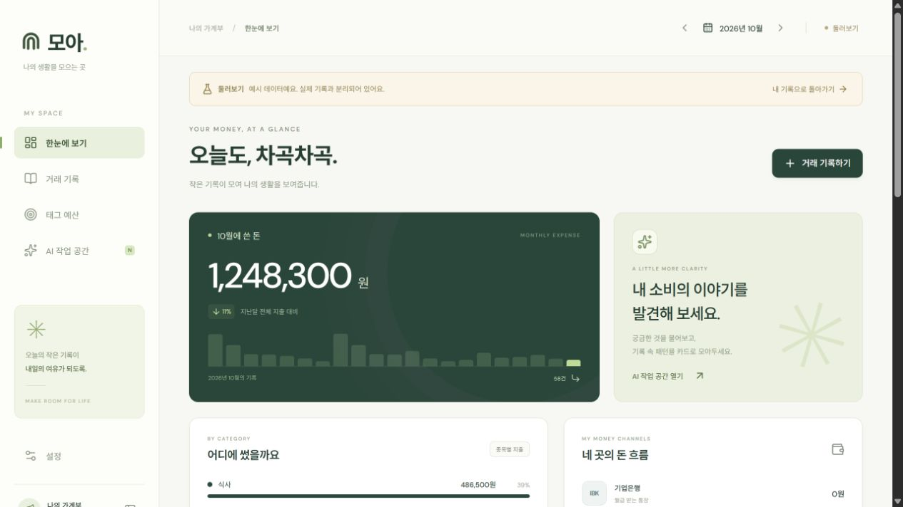
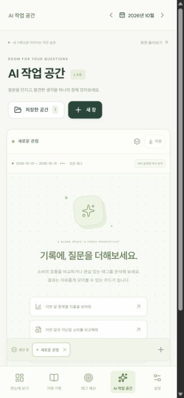

# 구현 검증 기록

## 설정의 단축어 설치 버튼

- iPhone 자동 수집 화면과 연결 안내 창에 토스·국민은행 설치 링크를 추가했다. 수집키 발급 창에서는 해당 출처의 설치파일을 제공한다. 로그인 전에도 키가 없는 공개 템플릿을 받을 수 있다.
- 프론트엔드 테스트 19개와 TypeScript 검사·운영 빌드를 통과했다. 공개 파일이 검증된 서명 원본과 일치하는지, Vercel이 다운로드 응답을 설정하고 누락된 설치파일을 앱 HTML로 바꾸지 않는지 확인한다.
- 로컬 Chrome에서 두 설치 링크를 각각 눌러 실제 파일을 받았다. 토스 24,310바이트, KB 24,320바이트이며 두 다운로드의 SHA256이 서명 원본과 일치했다. 운영 빌드에도 동일한 두 파일이 포함된다.
- 390px 모바일 화면에서 설치 버튼이 한 열로 표시되고 높이 46px, 가로 넘침 없음, 브라우저 경고·오류 로그 없음을 확인했다. 실제 iPhone의 가져오기·설치·실행은 별도 확인 대상이다.
- 이 변경은 프론트 재배포로 반영하며 백엔드 변경은 없다.

## iPhone 설치 파일 · 2026-10-31

- 토스·KB스타뱅킹용 수신 단축어 두 개를 생성하고 HubSign에서 AEA1 `.shortcut` 설치 파일로 서명했다. 개인 접속키·실제 수집키·금융 알림은 서명 서비스에 보내지 않았다. 설치 질문에 전용 헤더 값을 입력하는 구조다.
- 정적 테스트 6개로 빈 키·관리자키·불완전한 헤더·빈 본문의 전송 차단, 변수 참조와 제어 흐름, 실제 문자열의 JSON 연결, 고정 출처와 운영 HTTPS 주소를 확인했다. 이 테스트는 iOS 실행기의 동작을 대체하지 않는다.
- 서명된 두 파일을 독립적으로 풀어 원본의 전체 액션 21개와 설치 질문·본문 연결·헤더·전송 주소가 유지되는 것을 확인했다. Apple 서명기가 클라이언트 버전과 아이콘 메타데이터를 정규화했다. 인증서 신뢰와 iPhone의 가져오기·실제 실행은 별도 확인 대상이다.
- 설치 ZIP에는 서명 파일 두 개와 설치 안내만 포함하고 압축 무결성·원본 파일 일치를 확인했다. 사용자가 iOS 27.2의 알림 자동화에서 대상 앱과 본문 입력을 연결해야 한다. 실제 토스·KB 알림 전달과 잠금 상태 실행은 아직 검증하지 않았다.

## iPhone 단축어 수집 · 2026-10-31

- 운영 프론트의 최신 소스(`51ac649`)에 수집 기능을 통합했다. 기존 금융수단 보관·거래 수정·PC 표 입력과 Vercel `/api` 프록시 설정을 유지했다.
- 백엔드 구문 검사와 테스트 79개, 프론트엔드 테스트 17개 및 TypeScript 검사·운영 빌드를 통과했다. 전용 수집키 인증, 재전송 중복 방지, 불명확한 금액·취소·환불의 검토 처리, 보관 금융수단 차단과 백업 복원을 포함한다.
- 운영 DB와 분리한 로컬 SQLite 및 Chrome에서 가상 알림 12,500원을 수신했다. 최초 응답 `pending`, 같은 이벤트 재전송 `duplicate`, 검토 전 거래 0건을 확인했다. 수집함에서 확인 후 저장하여 기록됨 상태와 월 지출·토스 카드 지출 12,500원, 거래 1건이 반영되는 것을 확인했다.
- 같은 격리 서버에서 자동 기록을 켜고 새 가상 결제 23,400원을 보내 `recorded`와 거래 2건을 확인했다. 동일 이벤트를 재전송하자 원본 이벤트·거래 ID를 재사용한 `duplicate`로 응답했고 거래 수가 늘지 않았다. 시험 후 자동 기록은 다시 껐다.
- 390px 모바일에서 연결 양식 표시와 가로 넘침이 없음을 확인했다. 브라우저 경고·오류 로그가 없었다.
- 운영 `https://expense-tracker-lake-eight-39.vercel.app/api/health`의 정상 응답과 접속키 인증 사용 여부를 확인했다. 새 기능의 운영 배포는 사용자가 직접 진행한다. 사용자의 iPhone에서 단축어 설치·실제 금융 알림 전달·잠금 상태 실행은 검증하지 않았다. iOS 26.6은 실제로 받는 SMS를 이용하며 일반 앱 푸시 알림 자동 수집 경로를 지원하지 않는다.

## 금융수단 커스텀 · 2026-10-22

- 백엔드 테스트 56개와 표 입력 테스트 13개를 통과했다. 새로 분석한 금융수단·종목 ID를 저장하여 이름 변경 후 재분석 조건을 유지하는 회귀 테스트를 포함한다.
- 금융수단 추가·이름/설명/색상 수정·보관/해제·미사용 항목 삭제 API와 기존 SQLite 마이그레이션을 검증했다. 보관한 항목은 새 거래에서 제외하며 기존 거래 수정, 해당 월 집계, 구형 백업 복원과 재시작 후 데이터를 유지한다.
- 분리된 메모리 DB의 PC 브라우저에서 다섯 번째 금융수단 추가, 기본 항목 수정, 새 항목으로 거래 저장과 홈 집계를 확인했다. 390px 모바일에서 보관한 금융수단의 기존 거래 수정과 보관 해제를 확인했으며 가로 넘침이 없었다.
- 색상 코드를 저장한 뒤 재조회하여 실제 반영을 확인하고 잘못된 색상 코드는 저장하지 못하는지 확인했다. 기존 금융수단·종목 ID가 없는 구형 분석 저장본은 이름 변경 후 원래 조회 대상을 자동 복원하지 못하므로 재분석 전에 조건을 확인해야 한다.

## PC 표 입력 개선 · 2026-10-22

- 프론트엔드 TypeScript 검사·운영 빌드와 표 입력 테스트 12개 통과. Excel TSV의 따옴표·줄바꿈, 날짜·금액 정규화, 500행 제한, 오류 시 부분 저장 방지, 태그 연결 보존을 검증했다.
- 실제 서버 데이터와 분리한 메모리 DB에서 1440px PC 브라우저로 여러 행 붙여넣기, 셀 이동, 마지막 셀의 자동 행 추가, 행 복제·추가·복사, 오류 셀 표시, Ctrl+Enter 일괄 저장과 기존 거래 수정·금융수단 변경을 확인했다.
- 390px 모바일 브라우저에서 기존 날짜 중심 입력 폼과 목록을 유지하며 입력·저장 후 표시되는 것을 확인했다. PC와 모바일에서 페이지 가로 넘침과 브라우저 오류 로그가 없었다.

## 초기 구현 검증 · 2026-10-21

### 자동 확인

- 프론트엔드 TypeScript 검사 및 Vite 운영 빌드 통과.
- Node.js 24 백엔드의 구문 검사와 `node:test` 기반 API·분석 테스트 **44개 통과**. 거래 다건 입력 원자성, 참조·날짜·금액 검증, 수정 충돌, 예산 금액 승계와 미래 별도 설정 보존, 태그 OR/AND, 저장본 보존, 백업·복원과 재시작, 접속키, 실제 분석 연결을 포함한다.
- 5,001건을 전체 계산하는 분석 테스트를 포함한다. 큰 조회를 임의로 일부만 더하지 않는다.
- Docker Compose 구성 검증과 Node.js 24 Linux 이미지 빌드 통과.
- 실제 컨테이너에서 healthcheck, UID 10001 실행, 접속키 인증, Vercel origin CORS, 거래 입력·월 합계·분석·저장본·백업 HTTP 응답을 확인했다. 컨테이너를 삭제하고 같은 검증용 볼륨으로 새 컨테이너를 만든 뒤 거래 2건의 합계 15,700원과 저장본이 유지됨을 확인했다. 검증용 컨테이너와 볼륨은 종료 후 정리했다.
- 기존 Python 백엔드가 사용하던 SQLite 검증용 DB의 복사본에서 거래 2건·예산 1개·저장본 1개의 전체 데이터를 Node.js 백엔드가 동일하게 내보내는지 확인했다. 기존 JSON 백업의 복원도 통과했다.
- 실제 외부 서버 배포는 아직 진행하지 않았다.

### 초기 화면 브라우저 확인

아래 화면 검증은 백엔드 전환 전 초기 구현에서 수행했다. Node.js 전환 시 프론트엔드 코드와 API 형식을 유지했고, API 테스트와 실제 컨테이너 HTTP 요청으로 연결 동작을 확인했다.

실제 사용 DB와 구분한 로컬 검증용 SQLite 파일에서 진행했다.

- 12,500원과 3,200원을 다건 입력하여 월 지출 15,700원 표시 확인.
- 첫 거래를 12,900원으로 수정한 뒤 16,100원으로 반영되는 것 확인.
- 식사 막대 선택 시 그 금액에 포함된 원거래 2건 확인.
- 태그 생성과 30,000원 월 예산 설정, 다음 달에 동일 금액 승계 및 월 사용액 0원 확인.
- 종목별 분석 요청이 실제 거래 합계 16,100원 카드를 만드는 것 확인.
- 분석 저장 후 다른 메뉴를 다녀와도 열린 작업 창과 카드가 유지되는 것 확인.
- 390px 모바일 화면에서 가로 넘침이 없는 것 확인. 모바일 메뉴와 작업 공간 배치 확인.
- 마지막 화면의 브라우저 경고·오류 로그 없음.

수시 동기화는 표시 중 15초 주기 및 창 복귀·온라인 복귀에 동작하도록 구현했다. 분석 카드는 자동 재계산하지 않는다.

### 당시 연결 상태

- 실제 거래 초기 DB에는 예시 내역을 넣지 않는다. 별도의 둘러보기 화면에 58건의 예시 기록을 사용한다.
- 외부 AI 모델과 유료 API는 연결하지 않았다. 기본 분석은 규칙 기반임을 표시하며 실제 데이터 조회·계산으로 동작한다.
- 호환 API 연결 경로는 구현했고 외부 호출 부분은 모의 응답으로 검증했다. 선택한 실제 모델의 비용·품질·속도는 별도 측정이 필요하다.
- Vercel 프로젝트, Git 원격 저장소와 별도 서버 접속·도메인 정보는 아직 연결하지 않았다. 배포 설정과 실행 안내는 준비했다.

### 화면 기록

데스크톱은 둘러보기 예시이며, 모바일은 로컬 검증 화면이다.

