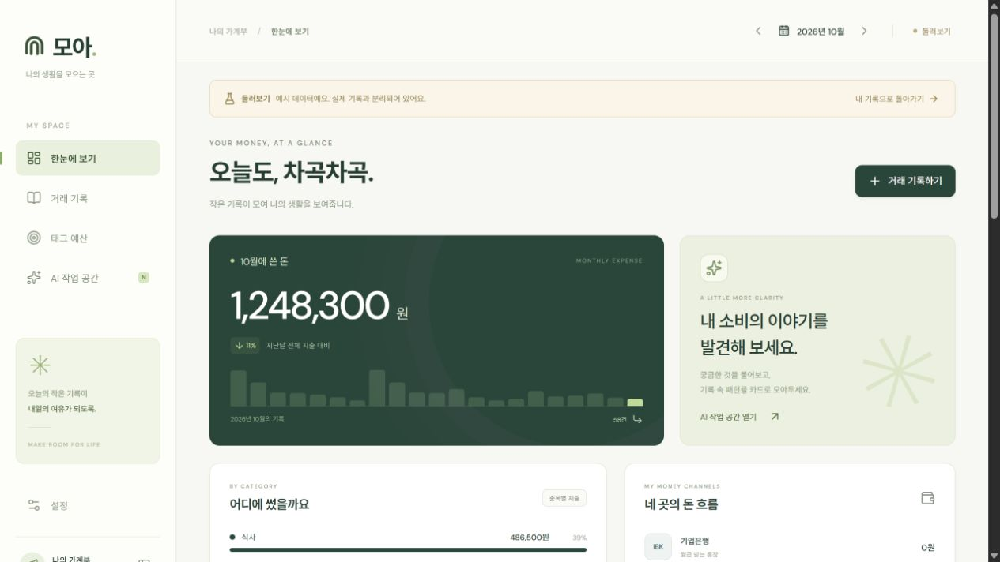
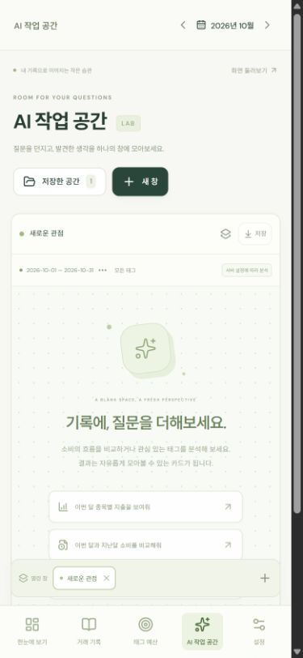

# 구현 검증 기록

검증일: 2026-10-21

## 자동 확인

- 프론트엔드 TypeScript 검사 및 Vite 운영 빌드 통과.
- Node.js 24 백엔드의 구문 검사와 `node:test` 기반 API·분석 테스트 **44개 통과**. 거래 다건 입력 원자성, 참조·날짜·금액 검증, 수정 충돌, 예산 금액 승계와 미래 별도 설정 보존, 태그 OR/AND, 저장본 보존, 백업·복원과 재시작, 접속키, 실제 분석 연결을 포함한다.
- 5,001건을 전체 계산하는 분석 테스트를 포함한다. 큰 조회를 임의로 일부만 더하지 않는다.
- Docker Compose 구성 검증과 Node.js 24 Linux 이미지 빌드 통과.
- 실제 컨테이너에서 healthcheck, UID 10001 실행, 접속키 인증, Vercel origin CORS, 거래 입력·월 합계·분석·저장본·백업 HTTP 응답을 확인했다. 컨테이너를 삭제하고 같은 검증용 볼륨으로 새 컨테이너를 만든 뒤 거래 2건의 합계 15,700원과 저장본이 유지됨을 확인했다. 검증용 컨테이너와 볼륨은 종료 후 정리했다.
- 기존 Python 백엔드가 사용하던 SQLite 검증용 DB의 복사본에서 거래 2건·예산 1개·저장본 1개의 전체 데이터를 Node.js 백엔드가 동일하게 내보내는지 확인했다. 기존 JSON 백업의 복원도 통과했다.
- 실제 외부 서버 배포는 아직 진행하지 않았다.

## 초기 화면 브라우저 확인

아래 화면 검증은 백엔드 전환 전 초기 구현에서 수행했다. Node.js 전환 시 프론트엔드 코드와 API 형식을 유지했고, API 테스트와 실제 컨테이너 HTTP 요청으로 연결 동작을 확인했다.

실제 사용 DB와 구분한 로컬 검증용 SQLite 파일에서 진행했다.

- 12,500원과 3,200원을 다건 입력하여 월 지출 15,700원 표시 확인.
- 첫 거래를 12,900원으로 수정한 뒤 16,100원으로 반영되는 것 확인.
- 식사 막대 선택 시 그 금액에 포함된 원거래 2건 확인.
- 태그 생성과 30,000원 월 예산 설정, 다음 달에 동일 금액 승계 및 월 사용액 0원 확인.
- 종목별 분석 요청이 실제 거래 합계 16,100원 카드를 만드는 것 확인.
- 분석 저장 후 다른 메뉴를 다녀와도 열린 작업 창과 카드가 유지되는 것 확인.
- 390px 모바일 화면에서 가로 넘침이 없는 것 확인. 모바일 메뉴와 작업 공간 배치 확인.
- 마지막 화면의 브라우저 경고·오류 로그 없음.

수시 동기화는 표시 중 15초 주기 및 창 복귀·온라인 복귀에 동작하도록 구현했다. 분석 카드는 자동 재계산하지 않는다.

## 현재 연결 상태

- 실제 거래 초기 DB에는 예시 내역을 넣지 않는다. 별도의 둘러보기 화면에 58건의 예시 기록을 사용한다.
- 외부 AI 모델과 유료 API는 연결하지 않았다. 기본 분석은 규칙 기반임을 표시하며 실제 데이터 조회·계산으로 동작한다.
- 호환 API 연결 경로는 구현했고 외부 호출 부분은 모의 응답으로 검증했다. 선택한 실제 모델의 비용·품질·속도는 별도 측정이 필요하다.
- Vercel 프로젝트, Git 원격 저장소와 별도 서버 접속·도메인 정보는 아직 연결하지 않았다. 배포 설정과 실행 안내는 준비했다.

## 화면 기록

데스크톱은 둘러보기 예시이며, 모바일은 로컬 검증 화면이다.

